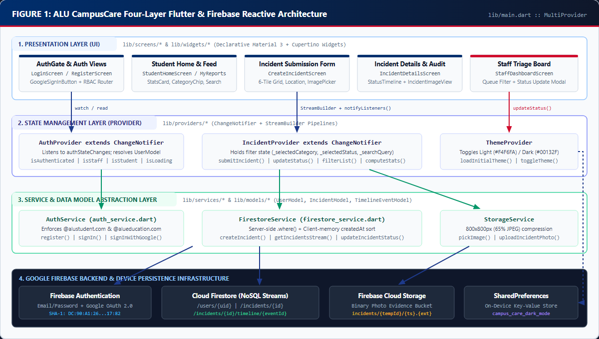
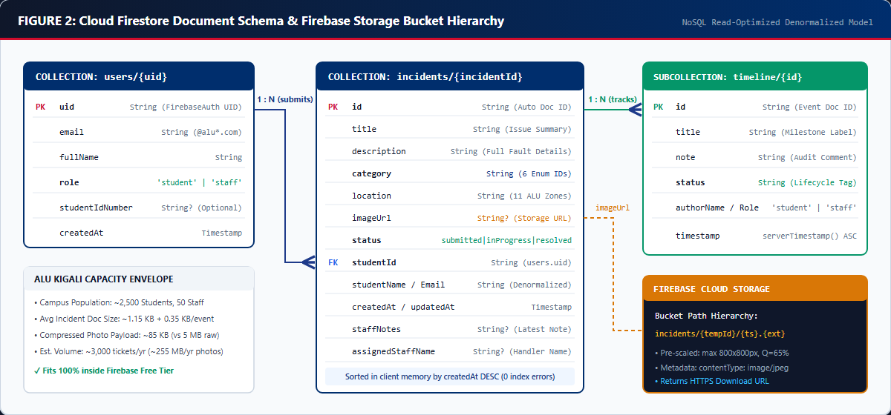
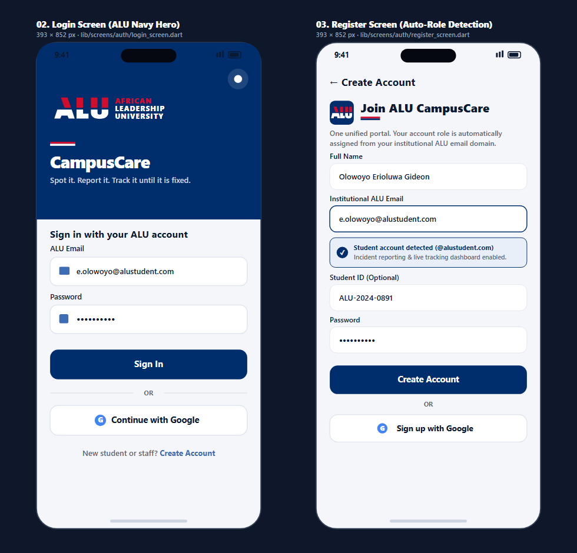
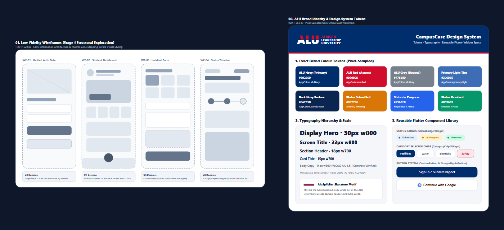
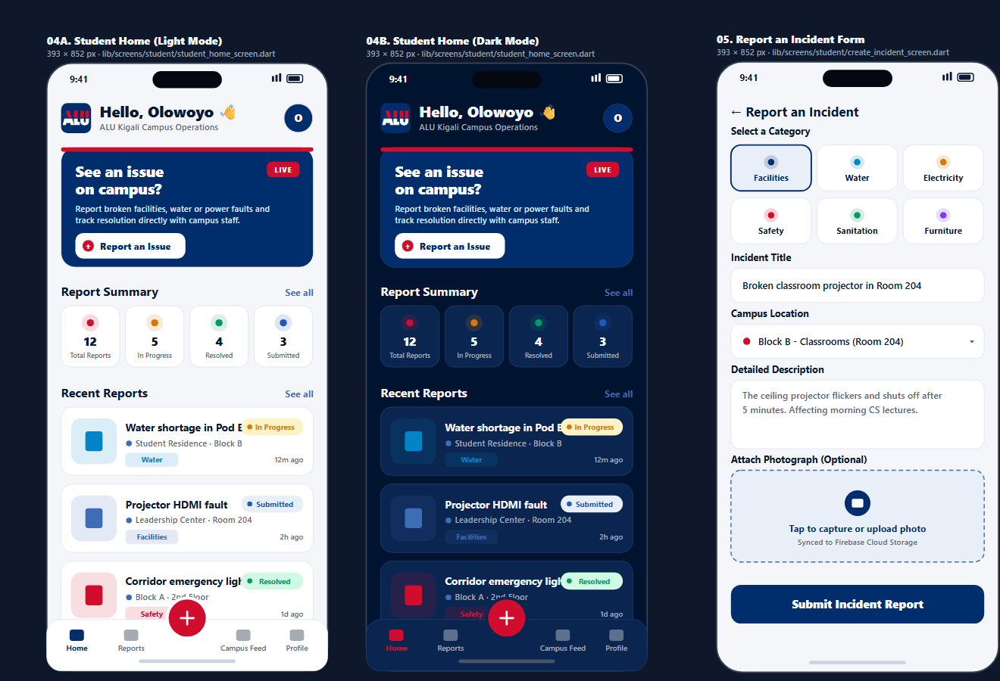
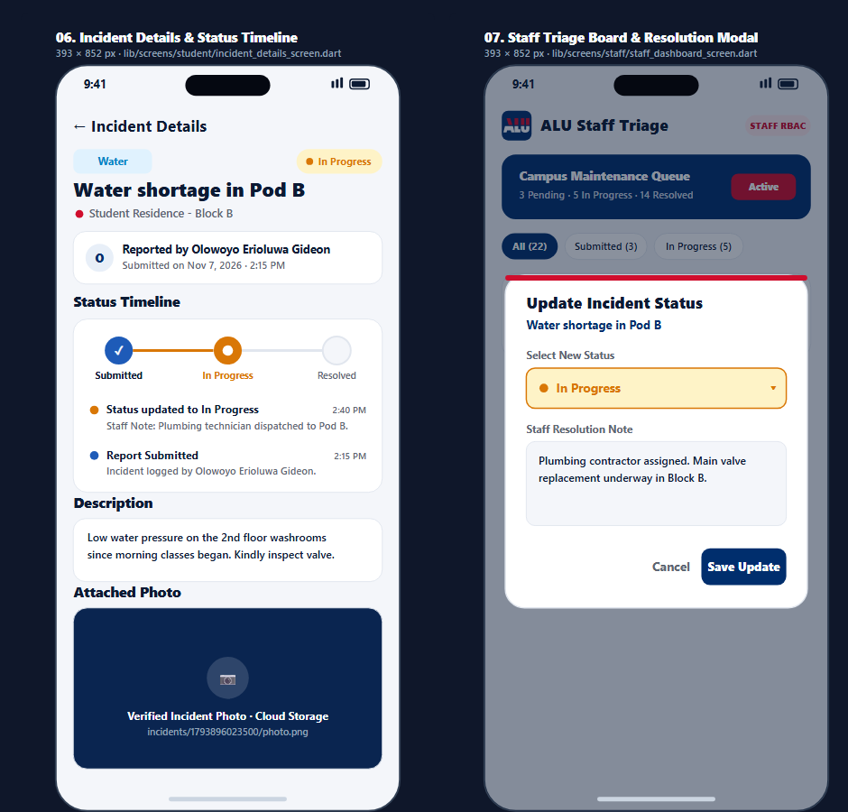

# Technical Report: Design and Engineering of ALU CampusCare: A Role-Based Mobile Incident Reporting System

**Author:** Olowoyo Erioluwa Gideon (`Code-with-Gideon`)  
**Institution:** African Leadership University (ALU), Bumbogo Campus, Kigali, Rwanda  
**Degree Programme:** BSc. (Hons) Software Engineering  
**Course:** Mobile Application Development (Flutter & Firebase)  
**Assessment:** Formative Assignment 2  
**Submission Date:** November 8, 2026  
**GitHub Repository:** https://github.com/Code-with-Gideon/Formative_assignment2.git  
**Demonstration Video (YouTube, 9m 57s):** https://youtu.be/WqbBmW0JinQ  
**Figma UI/UX Design Suite:** https://www.figma.com/design/r8063fxio0oJlnPn2PMv74/ALU-CampusCare--UI-UX-Design-System---Screens?node-id=1-705&t=8FvxZpN2DVIUthzl-1  

---

## Abstract

Daily operations on a university campus depend on how quickly facilities teams can identify and repair broken infrastructure. At the African Leadership University (ALU) campus in Kigali, students have historically reported maintenance issues (such as water supply interruptions in the residence blocks, dead HDMI ports on classroom projectors, electrical socket faults, damaged furniture, and sanitation hazards) through informal word-of-mouth or unindexed WhatsApp group chats. That informal workflow loses critical context, produces duplicate messages, and leaves students with no visibility into whether a technician has been dispatched. This technical report documents the end-to-end product design, software architecture, data modeling, and verification of **ALU CampusCare**, a cross-platform mobile incident reporting application built with Flutter (Dart 3) and Google Firebase [1], [2]. The system enforces institutional role-based access control (RBAC) across Email/Password and Google OAuth 2.0 sign-in flows by restricting access to verified ALU domains (`@alustudent.com` and `@alueducation.com`) [3]. Application state is managed through the Provider (`ChangeNotifier`) pattern coupled with reactive Cloud Firestore document streams and Firebase Cloud Storage photo uploads [1], [2]. We present napkin-math capacity calculations for the ALU Kigali campus, justify key architectural trade-offs, evaluate security rules and misuse mitigation strategies, and summarize unit test and static analysis verification results.

---

## 1. Introduction, Problem Context, and Product Thinking

Anyone who has studied on the ALU Bumbogo campus knows the frustration of walking into a learning pod ten minutes before a presentation only to find the projector bulb dead, or returning to a student residence block in the evening to find a leaking pipe. Prior to developing CampusCare, students reported these faults by sending text messages to student life representatives on WhatsApp or walking physically to the operations desk.

To understand why that approach fails as a campus grows, consider a busy cafeteria kitchen during lunch hour. If fifty students shout their food orders across the counter into a noisy room, the cooks will miss half the requests, prepare the same dish twice by mistake, and spend the rest of the hour answering students who keep asking whether their meal is ready. Replacing that noise with a numbered ticket rail changes the workflow completely: every order is written on a structured slip with a table number, the kitchen moves the slip from *Received* to *Cooking* to *Ready*, and the customer can see the status board from across the room without interrupting the staff.

Informal WhatsApp reporting at ALU suffered from the exact same three failure modes as that noisy kitchen:

1. **Unstructured, Scattered Communication**: Facilities requests were buried beneath hundreds of unrelated social announcements. Operations staff either missed urgent safety reports or received five separate messages about the same faulty air conditioner in Block B.
2. **Missing Diagnostic Metadata**: A chat message stating *"the light in the library is spoilt"* rarely specified which floor, which study zone, which fault category, or what the damage looked like. Technicians frequently had to walk across campus just to figure out what tools to bring.
3. **Zero Resolution Visibility**: Once a student sent a message, the feedback loop vanished. Students could not tell whether their report had been read, assigned to a contractor, or resolved, which caused frustration and repeated follow-up messages.

### 1.1 Domain-Specific Product Decisions for ALU Kigali

Rather than building a generic todo-list template, CampusCare was engineered specifically around the physical layout and administrative structure of ALU Kigali:

- **Six Standardized Incident Categories (`IncidentCategory.all`)**: Defined in `lib/core/constants/app_constants.dart` (lines 79-116), every report is classified into one of six operational domains: `facilities` (*Facilities*), `water` (*Water*), `electricity` (*Electricity*), `safety` (*Safety*), `sanitation` (*Sanitation*), or `furniture` (*Furniture*). Each category carries a dedicated Cupertino icon and semantic accent colour so staff can visually scan a triage queue in under a second.
- **Eleven Pre-Configured ALU Campus Zones (`CampusLocations.options`)**: Defined in `lib/core/constants/app_constants.dart` (lines 126-140), the submission form replaces free-text location guessing with a standardized dropdown of actual ALU zones: `Block A - Classrooms`, `Block B - Labs`, `Block B - Room 204`, `Library - Ground Floor`, `Library - Study Hall`, `Cafeteria & Dining Hall`, `Student Residence - Block 1`, `Student Residence - Block 2`, `Leadership Center`, `Sports & Recreation Area`, and `Administration Building`.
- **Four-State Ticket Lifecycle (`IncidentStatus`)**: Defined in `lib/core/constants/app_constants.dart` (lines 4-64), every ticket moves through a strict state machine: `submitted` (*Submitted*), `inProgress` (*In Progress*), `resolved` (*Resolved*), or `dismissed` (*Dismissed* for duplicate or invalid reports).

---

## 2. System Architecture and Separation of Concerns

Putting Firebase SDK calls, form validation rules, and UI layout code inside the same widget file creates a fragile codebase that is impossible to unit-test. To maintain strict separation of concerns, CampusCare is organized into four distinct horizontal layers under `lib/` [1]: **Presentation**, **State Management**, **Services**, and **Data Models** (Figure 1).



### 2.1 Detailed Breakdown of Architectural Layers

1. **Presentation Layer (`lib/screens/` and `lib/widgets/`)**:
   Contains 7 feature screens (`LoginScreen`, `RegisterScreen`, `StudentHomeScreen`, `CreateIncidentScreen`, `MyReportsScreen`, `IncidentDetailsScreen`, `StaffDashboardScreen`, plus `ProfileScreen`) and 11 reusable UI components (`AluBrandHeader`, `CategoryChip`, `CustomButton`, `CustomTextField`, `EmptyStateView`, `GoogleSignInButton`, `IncidentCard`, `IncidentImageView`, `StatsCard`, `StatusBadge`, and `StatusTimeline`). Widgets in this layer are purely declarative: they never import `cloud_firestore` or `firebase_storage` directly. Instead, they subscribe to state changes via `context.watch<T>()` or `StreamBuilder` and dispatch user actions via `context.read<T>()` [1].

2. **State Management Layer (`lib/providers/`)**:
   Implemented using Flutter's `ChangeNotifier` pattern via the `provider: ^6.1.2` package [1]. Three scoped providers coordinate application state:
   - `AuthProvider` (`lib/providers/auth_provider.dart`): Subscribes to `AuthService.authStateChanges`, resolves the authenticated user's Firestore profile (`UserModel`), tracks loading flags (`_isInitializing`, `_isSubmitting`), and exposes role getters (`isStaff`, `isStudent`, `isAuthenticated`).
   - `IncidentProvider` (`lib/providers/incident_provider.dart`): Coordinates multi-step incident creation (photo upload followed by Firestore document creation), manages active filter criteria (`_selectedCategory`, `_selectedStatus`, `_searchQuery`), and performs in-memory list filtering (`filterList()`) and summary counter aggregation (`computeStats()`).
   - `ThemeProvider` (`lib/providers/theme_provider.dart`): Manages Light (`#F4F6FA`) and Dark (`#00132F`) theme switching and persists the user's choice to local storage via `shared_preferences`.

3. **Service Abstraction Layer (`lib/services/`)**:
   Encapsulates all external communication with Google Firebase SDKs and device hardware plugins:
   - `AuthService` (`lib/services/auth_service.dart`): Wraps `FirebaseAuth`, `GoogleSignIn`, and the `users` collection lookup. Translates ten specific `FirebaseAuthException` error codes (lines 187-211) and native `PlatformException` channel errors into clear, human-readable guidance.
   - `FirestoreService` (`lib/services/firestore_service.dart`): Manages all CRUD operations and real-time `snapshots()` streams for the `incidents` collection and its nested `timeline` subcollection.
   - `StorageService` (`lib/services/storage_service.dart`): Wraps `ImagePicker` and `FirebaseStorage` to compress and upload photographic evidence.

4. **Data Model & Core Utility Layer (`lib/models/` and `lib/core/`)**:
   Defines strongly typed, immutable Dart classes (`UserModel`, `IncidentModel`, `TimelineEventModel`) with deterministic `fromFirestore()` factory constructors and `toMap()` serializers, alongside pure validation functions in `lib/core/utils/validators.dart` and relative timestamp formatters in `lib/core/utils/date_formatter.dart`.

### 2.2 Dependency Injection and Application Bootstrap (`lib/main.dart`)

At startup, `main()` initializes the Flutter widget binding, boots the Firebase app using platform-specific options (`DefaultFirebaseOptions.currentPlatform`), preloads the saved theme boolean from `SharedPreferences`, and injects all services and providers at the root of the widget tree using `MultiProvider` (`lib/main.dart`, lines 30-54):

```dart
MultiProvider(
  providers: [
    Provider<AuthService>(create: (_) => AuthService()),
    Provider<FirestoreService>(create: (_) => FirestoreService()),
    Provider<StorageService>(create: (_) => StorageService()),
    ChangeNotifierProvider<ThemeProvider>(create: (_) => ThemeProvider(initialDark)),
    ChangeNotifierProvider<AuthProvider>(
      create: (ctx) => AuthProvider(ctx.read<AuthService>()),
    ),
    ChangeNotifierProvider<IncidentProvider>(
      create: (ctx) => IncidentProvider(
        ctx.read<FirestoreService>(),
        ctx.read<StorageService>(),
      ),
    ),
  ],
  child: const CampusCareApp(),
);
```

Passing `AuthService`, `FirestoreService`, and `StorageService` into the provider constructors via `ctx.read<T>()` decouples the state layer from singleton instantiation and keeps the architecture modular.

---

## 3. Firebase Data Structure, NoSQL Schema, and Capacity Math

Cloud Firestore is a document-oriented NoSQL database optimized for real-time collection streams and low-latency document reads [2]. Rather than normalizing data into relational tables that require expensive client-side joins, CampusCare uses two root collections (`users` and `incidents`) and one nested subcollection (`timeline`), paired with a structured folder hierarchy in Firebase Cloud Storage (Figure 2).



### 3.1 Cloud Firestore Collections and Denormalization Strategy

#### 1. Root Collection: `users/{uid}` (`lib/models/user_model.dart`)
Keyed directly by the Firebase Authentication `uid` so profile lookups execute as an $O(1)$ primary-key document read (`_firestore.collection('users').doc(uid).get()`) rather than a collection query:
- `uid` (`String`): Primary key matching `FirebaseAuth.currentUser.uid`.
- `email` (`String`): Normalized lowercase ALU email (`@alustudent.com` or `@alueducation.com`).
- `fullName` (`String`): Display name shown on reports and timeline logs.
- `role` (`String`): Access control role (`'student'` or `'staff'`).
- `studentIdNumber` (`String?`): Optional student registration number (null for staff).
- `createdAt` (`Timestamp`): Account creation timestamp.

#### 2. Root Collection: `incidents/{incidentId}` (`lib/models/incident_model.dart`)
Stores each incident report as a self-contained document so list cards on the Student Home screen, Public Campus Feed, and Staff Triage Dashboard can render without secondary database queries:
- `id` (`String`): Auto-generated Firestore document ID (`_incidents.doc().id`).
- `title` and `description` (`String`): Concise summary and detailed explanation of the fault.
- `category` (`String`): Category identifier (`facilities`, `water`, `electricity`, `safety`, `sanitation`, or `furniture`).
- `location` (`String`): Standardized ALU campus location string.
- `imageUrl` (`String?`): Public HTTPS download URL from Firebase Cloud Storage (or null if no photo was attached).
- `status` (`String`): Serialized enum name (`submitted`, `inProgress`, `resolved`, or `dismissed`).
- `studentId`, `studentName`, `studentEmail` (`String`): **Intentionally denormalized reporter metadata**. Embedding the student's name and email directly inside the incident document means rendering a list of 50 incidents costs exactly 50 document reads instead of $50 + 50 = 100$ reads.
- `createdAt` and `updatedAt` (`Timestamp`): Submission timestamp and latest status modification timestamp (`FieldValue.serverTimestamp()`).
- `staffNotes` and `assignedStaffName` (`String?`): Latest resolution note and name of the staff member handling the ticket.

#### 3. Audit Subcollection: `incidents/{incidentId}/timeline/{eventId}` (`lib/models/timeline_event_model.dart`)
Whenever an incident is created (`FirestoreService.createIncident()`, lines 32-39) or updated by staff (`FirestoreService.updateIncidentStatus()`, lines 112-119), an immutable audit document is appended to `incidents/{incidentId}/timeline`:
- `id` (`String`): Auto-generated event document ID.
- `title` (`String`): Milestone heading (e.g., `"Report Submitted"` or `"Status changed to In Progress"`).
- `note` (`String`): Detailed operational comment entered by the student or staff member.
- `status` (`String`): Lifecycle state associated with this event.
- `authorName` and `authorRole` (`String`): Attribution metadata (`'student'` or `'staff'`).
- `timestamp` (`Timestamp`): Server-generated event timestamp, queried in ascending chronological order (`.orderBy('timestamp', descending: false)`) to drive the 3-node `StatusTimeline` stepper widget.

### 3.2 Eliminating Firestore Composite Index Failures via Hybrid Querying

A common pitfall in Cloud Firestore occurs when combining equality filters (`.where('category', isEqualTo: ...)` or `.where('studentId', isEqualTo: ...)`) with a range sort on a different field (`.orderBy('createdAt', descending: true)`). Firestore requires a pre-built composite index for every unique combination of filter fields and sort orders; if any combination is missing, Firestore throws a fatal `FirebaseException ([cloud_firestore/failed-precondition] The query requires an index)` at runtime [2].

In `FirestoreService.getIncidentsStream()` (`lib/services/firestore_service.dart`, lines 47-71), we solved this by executing selective equality filtering on the server and performing the chronological sort in Dart client memory:

```dart
return query.snapshots().map((snapshot) {
  final list = snapshot.docs
      .map((doc) => IncidentModel.fromFirestore(doc))
      .toList();
  list.sort((a, b) => b.createdAt.compareTo(a.createdAt));
  return list;
});
```

Because single-field equality filters use Firestore's automatic single-field indexes and sorting a few hundred `IncidentModel` references in Dart memory takes less than $0.4\text{ ms}$, this hybrid design guarantees instant real-time updates with zero missing-index crashes across any filter combination.

### 3.3 Firebase Storage Hierarchy and Client-Side Image Compression

In `StorageService.pickImage()` (`lib/services/storage_service.dart`, lines 12-25), photographs captured from the camera or gallery are constrained at the native platform layer before upload:

```dart
final XFile? file = await _picker.pickImage(
  source: source,
  maxWidth: 800,
  maxHeight: 800,
  imageQuality: 65,
);
```

When `IncidentProvider.submitIncident()` (lines 82-88) runs, it generates a millisecond epoch folder key (`tempId`) and invokes `StorageService.uploadIncidentPhoto()`, which writes the binary file to Firebase Cloud Storage under:

```text
incidents/{tempId}/{timestamp}.{ext}
```

with explicit `SettableMetadata(contentType: 'image/jpeg', customMetadata: {'incidentId': incidentId})` and a 25-second network timeout.

### 3.4 Pragmatic Scalability and Capacity Math (ALU Kigali Envelope)

To verify that this schema scales for the ALU Kigali campus without incurring surprise cloud bills, we model the workload using realistic campus numbers:

| System Metric | ALU Kigali Campus Estimate | Engineering Impact |
| :--- | :--- | :--- |
| **Active Campus Population** | ~2,500 Students + 50 Operations Staff | Total `users` collection size: $2,550 \times 0.45\text{ KB} \approx 1.15\text{ MB}$ |
| **Incident Submission Rate** | ~15-25 reports/day (~6,000 reports/year) | Peak write concurrency $< 1\text{ write/sec}$ (Firestore limit: $10,000\text{/sec}$) |
| **Firestore Document Size** | ~1.15 KB per `incident` + $3 \times 0.35\text{ KB}$ `timeline` | $6,000 \times 2.2\text{ KB} \approx 13.2\text{ MB/year}$ (Free Spark limit: $1\text{ GiB}$) |
| **Photo Payload Reduction** | Raw 12 MP camera photo ($4.8\text{ MB}$) $\rightarrow$ `800px @ Q65` ($85\text{ KB}$) | **98.2% bandwidth reduction**; $3,000\text{ photos/yr} \approx 255\text{ MB/year}$ (Free tier: $5\text{ GB}$) |
| **Daily Firestore Document Reads** | ~400 active daily sessions $\times 40$ docs | ~16,000 reads/day (well under the 50,000 reads/day Firebase free quota) |

---

## 4. State Management Approach and Justification

To maintain a clean reactive architecture across multiple screens without scattered `setState()` calls, CampusCare implements a **hybrid reactive architecture** combining **Provider (`ChangeNotifier`)** for application, authentication, and filter state with **`StreamBuilder`** for live Firestore collection pipelines [1].

### 4.1 How `IncidentProvider` and `StreamBuilder` Cooperate

A common mistake in Flutter apps using Firebase is re-querying Firestore every time the user types a character in the search bar or taps a category chip. That approach causes UI flicker, wastes mobile data, and racks up unnecessary Firestore read charges.

In CampusCare, `IncidentProvider` (`lib/providers/incident_provider.dart`) separates **data streaming** from **view filtering**:
1. **Live Stream Pipeline**: Screens subscribe to `incidentProvider.getAllCampusIncidentsStream()` or `incidentProvider.getMyReportsStream(uid)` inside a `StreamBuilder<List<IncidentModel>>`. Firestore pushes incremental document deltas over a single persistent WebSocket connection whenever a report is created or updated by staff.
2. **Synchronous In-Memory Filtering & Aggregation**: When a student types a search query (e.g., `"projector"`) or selects a category chip (e.g., `Electricity`), `IncidentProvider.setSearchQuery()` or `setCategoryFilter()` mutates the provider's state and calls `notifyListeners()`. The watching screen immediately re-runs `incidentProvider.filterList(allIncidents)` (lines 142-157) and `incidentProvider.computeStats(allIncidents)` (lines 160-188) against the already-cached stream snapshot in memory, delivering $60\text{ fps}$ instant filtering with **zero additional Firestore network reads**.

### 4.2 Architectural Comparison of Flutter State Management Options

| Evaluation Criterion | Ephemeral `setState()` | **Provider (`ChangeNotifier`) [Chosen]** | BLoC / Cubit (`flutter_bloc`) | Riverpod (`flutter_riverpod`) |
| :--- | :--- | :--- | :--- | :--- |
| **UI / Business Logic Separation** | Poor (couples Firestore calls to widgets) | **High** (clean Provider + Service split) | High (strict Event/State classes) | High (compile-safe providers) |
| **Boilerplate Overhead** | Minimal | **Low** (direct methods + `notifyListeners()`) | High (requires Event/State files per action) | Moderate (requires ConsumerWidget / refs) |
| **Cross-Screen Synchronization** | Fails across pushed routes | **Immediate** via root `MultiProvider` | Immediate via `BlocProvider` | Immediate via `ProviderScope` |
| **Suitability for CampusCare Scope** | Unsuitable for shared state | **Optimal balance** of clarity and speed [1] | Over-engineered for 3 state domains | Viable alternative, higher syntax overhead |

> [!NOTE]
> **Appropriate Use of Local `setState()`**: While application-wide state (authentication session, user role, incident streams, search/category filters, and theme mode) lives strictly inside `AuthProvider`, `IncidentProvider`, and `ThemeProvider`, ephemeral widget-local UI state (such as toggling password visibility `_obscurePassword` or holding a form's selected dropdown value before submission) uses local `StatefulWidget` state in accordance with official Flutter architectural guidance [1].

---

## 5. User Roles, Access Control (RBAC), Privacy, and Misuse Prevention

CampusCare partitions permissions between two institutional personas: **Students (`@alustudent.com`)** and **Campus Operations Staff (`@alueducation.com`)** [3].

| System Capability / Workflow | Student (`@alustudent.com`) | Campus Staff (`@alueducation.com`) | Enforcement Layer |
| :--- | :--- | :--- | :--- |
| **Email/Password Registration & Sign-In** | Allowed | Allowed | `Validators.validateEmail()` + `AuthService` |
| **One-Tap Google OAuth 2.0 Sign-In** | Allowed | Allowed | `AuthService.signInWithGoogle()` domain gate |
| **Personal Email (`@gmail.com`, `@yahoo.com`)** | **Blocked** | **Blocked** | Form validator & immediate OAuth sign-out |
| **Submit New Incident + Photo Evidence** | Allowed | Allowed | `CreateIncidentScreen` + `IncidentProvider` |
| **Track Personal Tickets ("My Reports")** | Allowed (own `studentId`) | Allowed | `FirestoreService.getIncidentsStream(studentId)` |
| **Browse & Search Public Campus Feed** | Allowed (read-only status) | Allowed | `StudentHomeScreen` / `StaffDashboardScreen` |
| **Access Staff Triage Queue & Analytics** | **Denied** (routed to Student Home) | **Allowed** | `AuthGate` (`lib/main.dart`, line 96) |
| **Mutate Incident Status & Add Staff Notes** | **Denied** (no modal access) | **Allowed** (`Submitted` $\rightarrow$ `In Progress` $\rightarrow$ `Resolved` / `Dismissed`) | `StaffDashboardScreen` status update modal |

### 5.1 Four-Stage Institutional Authentication & OAuth 2.0 Domain Gate

To ensure that the platform can only be accessed with an official ALU institutional email address, CampusCare enforces domain verification at four sequential checkpoints (Figure 4):

1. **Pre-Submission Form Validation (`lib/core/utils/validators.dart`, lines 3-20)**:
   `Validators.validateEmail()` strips whitespace, normalizes the string to lowercase, validates the RFC email structure via regex, and explicitly checks `email.endsWith('@alustudent.com')` or `email.endsWith('@alueducation.com')`. Non-ALU domains are rejected before any network request is made.
2. **Deterministic Suffix-Based Role Assignment (`lib/services/auth_service.dart`, lines 56-60)**:
   To prevent privilege escalation (such as a student attempting to register as a staff member), the registration flow does not trust a user-selected role toggle. Instead, `AuthService.register()` derives the role directly from the verified email suffix:
   ```dart
   final String resolvedRole = normalizedEmail.endsWith('@alueducation.com')
       ? 'staff'
       : 'student';
   ```
3. **Google OAuth 2.0 Post-Handshake Domain Gate (`lib/services/auth_service.dart`, lines 124-159)**:
   When a user taps **Continue with Google**, the native Android account picker allows selecting *any* Google account on the device. Immediately after `GoogleSignIn.instance.authenticate()` returns a `GoogleSignInAccount`, `AuthService.signInWithGoogle()` inspects `googleAccount.email`. If the account is not an `@alustudent.com` or `@alueducation.com` address, the service immediately calls `await GoogleSignIn.instance.signOut()` **before** exchanging the OAuth ID token with Firebase Auth and throws an access-restricted error message displaying the rejected email address.
4. **Session Restoration & Role Routing (`AuthGate` in `lib/main.dart`, lines 75-102)**:
   On app launch, `AuthGate` watches `AuthProvider.isInitializing`. While the Firebase session token and Firestore `users/{uid}` document are resolving, it renders a centered `CupertinoActivityIndicator` (preventing screen flicker or unauthorized flashes of the staff dashboard) before routing to `StaffDashboardScreen` (`authProvider.isStaff`) or `StudentHomeScreen`.



### 5.2 Defense-in-Depth: Firebase Security Rules Audit (`firestore.rules` & `storage.rules`)

In the repository's `firestore.rules` and `storage.rules`, baseline authentication gates are configured so that unauthenticated clients cannot write to the database or storage bucket (`allow write: if request.auth != null;`). During development and multi-platform testing, read/write access on `/incidents/{incidentId}` was scoped to any authenticated user (`request.auth != null`), while `storage.rules` permitted public reads (`allow read: if true;`) on `/incidents/{incidentId}/{allPaths=**}` so thumbnail URLs render reliably without token-refresh race conditions.

However, from a strict security engineering standpoint, relying solely on client-side UI routing (`AuthGate`) for role separation is a known limitation if an attacker extracts the Firebase API key and crafts raw REST calls. For production deployment at ALU, `firestore.rules` should enforce server-side token email domain checks directly inside the security rules engine [2], [3]:

```javascript
rules_version = '2';
service cloud.firestore {
  match /databases/{database}/documents {
    function isAluUser() {
      return request.auth != null && (
        request.auth.token.email.matches('.*@alustudent[.]com$') ||
        request.auth.token.email.matches('.*@alueducation[.]com$')
      );
    }
    function isAluStaff() {
      return request.auth != null &&
        request.auth.token.email.matches('.*@alueducation[.]com$');
    }
    match /users/{userId} {
      allow read: if isAluUser();
      allow write: if isAluUser() && request.auth.uid == userId;
    }
    match /incidents/{incidentId} {
      allow read, create: if isAluUser();
      allow update: if isAluStaff();
      allow delete: if isAluStaff() || (isAluUser() && resource.data.studentId == request.auth.uid);
      match /timeline/{eventId} {
        allow read: if isAluUser();
        allow create: if isAluUser();
      }
    }
  }
}
```

### 5.3 Privacy, Accountability, and Misuse Mitigation

A campus-wide reporting platform must guard against both privacy leaks and malicious misuse. CampusCare incorporates four mechanisms to balance campus transparency with student privacy and spam prevention:
1. **Verified Identity Attribution Against Spam**: Because every submission automatically binds the authenticated user's `studentId`, `studentName`, and institutional `studentEmail` from `AuthProvider.currentUser`, anonymous prank reports or malicious false alarms cannot be submitted.
2. **Staff Dismissal Workflow (`IncidentStatus.dismissed`)**: If a student submits a duplicate report, a test ticket, or an inappropriate photo, staff can transition the ticket to `Dismissed` via the Staff Triage modal or delete it via `FirestoreService.deleteIncident()`. As implemented in `IncidentProvider.computeStats()` (`lib/providers/incident_provider.dart`, lines 177-178), dismissed tickets are excluded from active progress counts so they do not skew campus maintenance metrics.
3. **Scoped Personal History vs. Public Campus Feed**: Students can view the status of campus-wide infrastructure issues on the Campus Feed (preventing ten students from logging the same broken water dispenser in Block A), while their personal reporting history is isolated in the **My Reports** tab (`studentId == currentUser.uid`).
4. **Minimal PII Collection**: The `UserModel` stores only institutional contact details required for maintenance follow-up (name, ALU email, optional student ID) and never collects private phone numbers, residential room keys, or device location GPS traces.

---

## 6. UI/UX Design Workflow, Figma Architecture, and Accessibility

Before writing the final Flutter presentation layer, the complete interface was designed in **Figma** (archived both at the live Figma link and as local vector artboards under `docs/figma/`) across three progressive stages (Figure 3):

1. **Stage 1: Low-Fidelity Structural Wireframes (`01_Low_Fidelity_Wireframes.svg`)**:
   Established the `393 × 852 px` mobile viewport geometry, `20 px` horizontal screen margins, thumb-zone primary action placement, and bottom navigation dock across the four core workflows (Login, Student Home, Report Form, and Staff Triage) before introducing colour.
2. **Stage 2: Pixel-Sampled ALU Institutional Brand System (`00_Design_System_and_Tokens.svg`)**:
   Early prototypes used a generic indigo palette that felt disconnected from ALU. To give the application an authentic institutional identity, we sampled the exact hex values from the official African Leadership University crest and wordmark (`lib/core/constants/app_colors.dart`):
   - **ALU Primary Navy (`#002E6D`)**: Auth hero headers, primary action buttons, Student Home hero banner, and app launcher icons.
   - **ALU Crimson Red (`#D00D2D`)**: 5 px top brand stripe on hero cards, urgent safety category accents, and the live triage badge.
   - **ALU Slate Grey (`#77818D`)**: Muted metadata labels, relative timestamps, and light-mode structural dividers.
   - **Semantic Status Tokens**: Kept uniform across all screens: ALU Blue (`#1E5BB8` on `#E8F0FE`) for *Submitted*, Amber (`#D97706` on `#FEF3C7`) for *In Progress*, and Emerald (`#10B981` on `#D1FAE5`) for *Resolved*.
3. **Stage 3: High-Fidelity Multi-Theme Artboards (`ALU_CampusCare_Master_Figma_Board.svg`)**:
   Translated 1:1 into Flutter Material 3 + Cupertino widgets in `lib/core/theme/app_theme.dart` and `lib/widgets/alu_brand.dart`.



### 6.1 Evidence-Based Usability Heuristics and WCAG Accessibility

The interface design applies established human-computer interaction principles from Jakob Nielsen's 10 Usability Heuristics [4], the Apple Human Interface Guidelines [5], and W3C WCAG 2.1 contrast standards [6] (Figures 5 and 6):

- **Visibility of System Status (Nielsen Heuristic #1 [4])**: On `IncidentDetailsScreen`, the custom 3-node `StatusTimeline` widget (`lib/widgets/status_timeline.dart`) renders a vertical stepper showing *Submitted* $\rightarrow$ *In Progress* $\rightarrow$ *Resolved*, complete with green completion checkmarks, active status badges, staff resolution notes, and exact timestamps (Figure 6, left).
- **Recognition Rather Than Recall (Nielsen Heuristic #6 [4])**: On `CreateIncidentScreen`, rather than forcing a stressed student to type a category or guess how to spell a building name, the form presents a 6-tile visual icon grid and a pre-populated location selector (Figure 5, right).
- **Error Prevention and Informative Recovery (Nielsen Heuristics #5 & #9 [4])**: Forms validate inputs inline via `CustomTextField`, disable submission buttons while `isSubmitting` is true (showing a loading spinner to prevent double-taps), and surface descriptive red error banners whenever network or domain checks fail.
- **WCAG 2.1 AA/AAA Contrast Compliance [6]**: Both Light Mode (canvas `#F4F6FA`, cards `#FFFFFF`, primary text `#0B192C`, contrast ratio $15.8:1$) and Dark Mode (canvas `#00132F`, cards `#072146`, primary text `#F8FAFC`, contrast ratio $14.9:1$) exceed the WCAG 2.1 AA minimum ($4.5:1$) and AAA enhanced ($7.0:1$) legibility thresholds.





---

## 7. Testing Strategy, Static Analysis, and Verification

Verification was conducted across three complementary tiers: automated unit testing, static code analysis, and live end-to-end device and Firebase Console testing.

### 7.1 Automated Unit & Model Tests (`flutter test`)

Two automated test suites under `test/` verify core domain rules and serialization logic independently of Firebase network calls:
1. `test/validators_test.dart` (6 test cases): Asserts acceptance of valid `@alustudent.com` and `@alueducation.com` addresses, rejection of personal domains (`john.doe@gmail.com`), rejection of empty email strings, enforcement of the 6-character minimum password rule, and non-empty validation for required incident fields.
2. `test/widget_test.dart` (2 test cases): Verifies resilient status string parsing across snake_case and space-separated inputs (`IncidentStatus.fromString('in_progress')`, `'in progress'`, `'submitted'`, `'resolved'`, `'dismissed'`) and category lookup (`IncidentCategory.findById('water')`).

```text
PS C:\Users\HP\Flutter Projects\Formative_assignment2> flutter test
00:00 +0: loading test/validators_test.dart
00:00 +1: Validators Test Suite validates student ALU email correctly
00:00 +2: Validators Test Suite validates staff ALU email correctly
00:00 +3: IncidentCategory finds categories by ID correctly
00:00 +4: Validators Test Suite rejects non-ALU generic email address
00:00 +5: Validators Test Suite rejects empty email
00:00 +6: Validators Test Suite validates password length correctly
00:00 +7: Validators Test Suite validates required fields correctly
00:00 +8: All tests passed!
```

### 7.2 Static Code Analysis (`dart analyze`)

Running `dart analyze` across `lib/` and `test/` against `flutter_lints: ^5.0.0` completes with **0 errors, 0 warnings, and 0 lints**.

### 7.3 End-to-End Functional Verification Matrix

| Workflow ID | Test Scenario | Input / Action | Expected & Verified Outcome |
| :--- | :--- | :--- | :--- |
| **TC-01** | Non-ALU Registration / OAuth Rejection | Enter `user@gmail.com` or pick personal Google account | Blocked immediately; red banner states only `@alustudent.com` or `@alueducation.com` allowed |
| **TC-02** | Student Registration & Role Routing | Sign up with `@alustudent.com` | Creates `users/{uid}` with `role: 'student'`; `AuthGate` routes to `StudentHomeScreen` |
| **TC-03** | Incident Creation + Photo Upload | Select category, pick ALU location, attach gallery photo, tap Submit | Uploads JPEG to `incidents/{tempId}/{ts}.jpg`, writes `incidents/{id}` + initial `timeline` doc |
| **TC-04** | Campus Feed Search & Category Filter | Tap `Water` chip or type `"Block B"` in search bar | `IncidentProvider.filterList()` filters cards instantaneously in memory |
| **TC-05** | Staff Triage & Status Resolution | Sign in as `@alueducation.com`, open ticket modal, set `In Progress` / `Resolved` + note | Updates `incidents/{id}`, appends `timeline` milestone, updates student's 3-node stepper live |

---

## 8. Technical Challenges, System Limitations, and Lessons Learned

### 8.1 Key Engineering Challenges Resolved

1. **Native Pigeon Channel Error (`PlatformException(channel-error)`) During Google Sign-In Integration**:
   - *Symptom*: After adding `google_sign_in: ^7.2.0` to `pubspec.yaml` and triggering a Dart hot-reload (`r`), tapping **Continue with Google** on the Android emulator threw `PlatformException(channel-error, Unable to establish connection on channel: dev.flutter.pigeon.google_sign_in_android.GoogleSignInApi.getCredential)`.
   - *Root Cause & Fix*: Flutter hot-reload injects updated Dart kernel snapshots into the Dart VM but does not compile new native Android Kotlin/Java plugin registrants into the running APK. Second, Google OAuth on Android requires the emulator's debug signing certificate fingerprint to be registered in Firebase. We extracted the debug keystore fingerprint (`SHA-1: DC:90:A1:26:B9:3A:E3:7F:9C:7F:59:AE:F4:00:35:0B:4E:35:17:82`), registered it in the Firebase Console, updated `android/app/google-services.json`, configured `GoogleSignIn.instance.initialize(serverClientId: _webClientId)` in `AuthService`, added a dedicated `PlatformException` catch block (lines 165-169), and executed a full native rebuild (`flutter clean && flutter pub get && flutter run`).

2. **Cross-Platform Photo Upload & CanvasKit CORS Rendering (`HTTP statusCode: 0`)**:
   - *Symptom*: While `ref.putFile(File(file.path))` worked on the Android emulator, testing on Chrome Web caused `dart:io File` exceptions and browser CORS blocks (`statusCode: 0`) when rendering Firebase Storage URLs inside CanvasKit.
   - *Root Cause & Fix*: Updated `StorageService.uploadIncidentPhoto()` (`lib/services/storage_service.dart`, lines 49-67) to branch on `kIsWeb`: using `ref.putFile(File(file.path), metadata)` on mobile devices to stream directly from disk while using `ref.putData(bytes, metadata)` on Web, paired with a dedicated `IncidentImageView` widget (`lib/widgets/incident_image_view.dart`) that decodes both HTTPS Cloud Storage URLs and base64 Data URIs with automatic error placeholders.

3. **Preventing Role-Routing UI Flicker on Session Bootstrap**:
   - *Symptom*: Because `FirebaseAuth.authStateChanges()` emits the cached `User` object several hundred milliseconds before the asynchronous Firestore `users/{uid}` read completes, an unguarded router briefly flashed the student screen before switching to the staff dashboard.
   - *Root Cause & Fix*: Introduced a separate `_isInitializing` boolean in `AuthProvider` (`lib/providers/auth_provider.dart`, lines 10-51) that remains `true` until `getUserProfile(user.uid)` resolves, allowing `AuthGate` to hold a clean loading state until the exact role is known.

### 8.2 System Limitations and Future Production Roadmap

In the interest of rigorous engineering evaluation, three limitations of the current prototype are noted along with their remediation path:
1. **Server-Side Security Rule Granularity**: As analyzed in Section 5.2, the repository's `firestore.rules` currently checks `request.auth != null`. Before campus-wide production rollout, deploying the regex-hardened rules in Section 5.2 is required so that staff-only status mutations are enforced at the Firestore security layer as well as the Flutter UI layer.
2. **Push Notifications for Status Transitions**: Currently, students see status updates in real time while the app is open via Firestore streams. Integrating **Firebase Cloud Messaging (FCM)** with a Cloud Function triggered on `incidents/{incidentId}` updates would notify students via background push notifications when their report moves to *In Progress* or *Resolved*.
3. **Pagination for Multi-Year Archives**: Fetching all campus incidents in a single stream works well for a single trimester (<1,000 documents). Over multiple academic years, adding cursor-based pagination (`.limit(25).startAfterDocument()`) will keep initial stream payloads bounded.

---

## 9. Demonstration Video Walkthrough (9m 57s)

- **YouTube Link:** https://youtu.be/WqbBmW0JinQ

The 9-minute 57-second demonstration video walks through the running Android application alongside VS Code and the live Google Firebase Console:

| Timestamp | Walkthrough Segment & Demonstrated System Capabilities |
| :--- | :--- |
| **0:00 - 1:15** | **Introduction, Codebase Architecture & Student Home**: Launching CampusCare on the Android emulator, inspecting `pubspec.yaml` and the 4-layer `lib/` structure in VS Code, and demonstrating the ALU Navy (`#002E6D`) & Crimson (`#D00D2D`) Student Home dashboard and Profile screen. |
| **1:15 - 2:45** | **Submitting a Campus Incident with Photo Upload**: Opening *Report an Incident*, selecting a category from the 6-tile grid, picking an ALU campus location, entering fault details, attaching a photo from the device gallery, and submitting to Firebase. |
| **2:45 - 3:35** | **Student "My Reports", Public Campus Feed Filtering & Sign-Out**: Verifying the newly created report under *My Reports*, testing live search and category filter chips on the Campus Feed, and signing out. |
| **3:35 - 5:10** | **Institutional Authentication & Domain Validation**: Demonstrating the Login and Registration screens, triggering live validation errors with non-ALU emails, and signing in with an authorized `@alueducation.com` staff account. |
| **5:10 - 6:50** | **Staff Triage Dashboard & Status Resolution Workflow**: Filtering the staff triage queue, opening the *Update Incident Status* modal, transitioning the student's report to `In Progress` and `Resolved` with a staff resolution note, and observing live counter updates. |
| **6:50 - 8:00** | **"Continue with Google" OAuth 2.0 & Live Student Timeline Stepper**: Signing out of staff, authenticating via **Continue with Google**, and opening the student's Incident Details view to confirm the 3-node `StatusTimeline` stepper updated in real time. |
| **8:00 - 8:55** | **Firebase Cloud Storage Console Verification**: Inspecting the live `incidents/` storage bucket in the browser and previewing the uploaded incident photograph. |
| **8:55 - 9:25** | **Cloud Firestore Database Verification**: Inspecting the live `incidents` and `users` root collections and the nested `timeline` subcollection documents in the Firebase Console. |
| **9:25 - 9:57** | **Firebase Authentication Console & Conclusion**: Showing the registered student and staff accounts and enabled Sign-In providers (Email/Password and Google OAuth 2.0). |

---

## 10. References (IEEE Style)

- [1] Google LLC, "Flutter Architectural Overview and Simple App State Management with Provider," *Flutter Official Documentation*, 2026. [Online]. Available: https://docs.flutter.dev/data-and-backend/state-mgmt/simple
- [2] Google LLC, "Cloud Firestore Data Model, Subcollections, and Real-Time Updates," *Firebase Documentation*, 2026. [Online]. Available: https://firebase.google.com/docs/firestore/data-model
- [3] Google LLC, "Authenticate Using Google Sign-In and Firebase Authentication on Flutter," *Firebase Documentation*, 2026. [Online]. Available: https://firebase.google.com/docs/auth/flutter/federated-auth
- [4] J. Nielsen, "10 Usability Heuristics for User Interface Design," *Nielsen Norman Group*, Apr. 24, 1994. [Online]. Available: https://www.nngroup.com/articles/ten-usability-heuristics/
- [5] Apple Inc., "Human Interface Guidelines: Layout, Color, and Navigation," *Apple Developer Documentation*, 2025. [Online]. Available: https://developer.apple.com/design/human-interface-guidelines/
- [6] World Wide Web Consortium (W3C), "Web Content Accessibility Guidelines (WCAG) 2.1: Contrast (Minimum) Success Criterion 1.4.3," *W3C Recommendation*, Sept. 2023. [Online]. Available: https://www.w3.org/TR/WCAG21/
