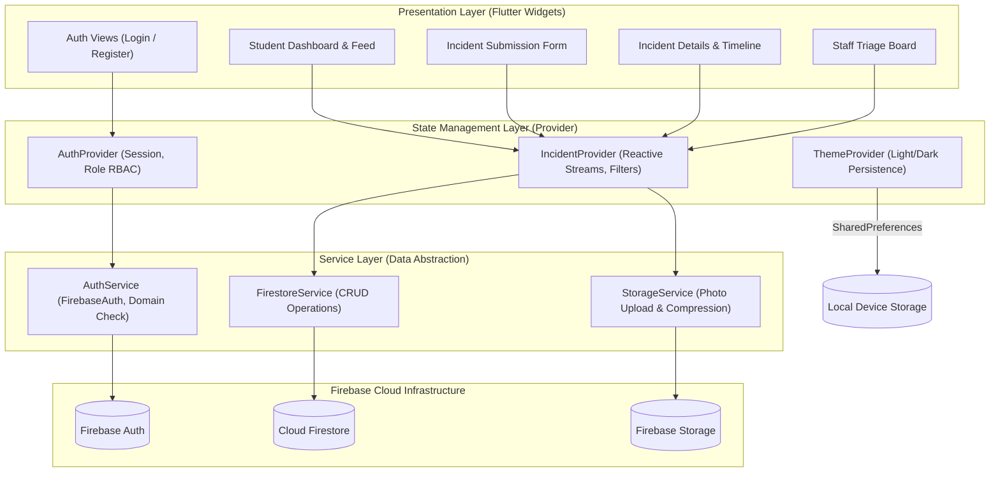
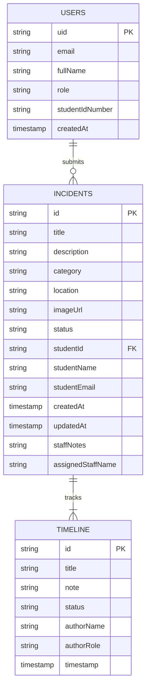

# Technical Report: Design and Implementation of a Campus Incident Reporting Application (CampusCare)

**Author:** Gideon Olowoyo (Code-with-Gideon)  
**Institution:** African Leadership University (ALU), Rwanda  
**Course:** Mobile Application Development (Flutter & Firebase)  
**Deliverable:** Formative Assignment 2 (Individual Assignment 2)  
**Repository:** [https://github.com/Code-with-Gideon/Formative_assignment2.git](https://github.com/Code-with-Gideon/Formative_assignment2.git)  
**Demonstration Video:** [Insert 7-10 Minute Demonstration Video Link Here]  

---

## Abstract

Campus operations and facility maintenance are fundamental to creating an effective learning environment in higher education institutions. At the African Leadership University (ALU) campus in Kigali, reporting maintenance issues such as water shortages, electricity faults, broken classroom projectors, damaged furniture, and sanitation concerns has traditionally relied on fragmented, informal communication channels. This report presents the design, technical architecture, and implementation of **CampusCare**, a cross-platform mobile application developed using Flutter, Firebase Authentication, Cloud Firestore, Firebase Storage, and the Provider state management pattern. The application implements role-based access control (RBAC) separating student incident reporting workflows from administrative staff triage operations. Institutional security is enforced through domain-restricted email authentication (`@alustudent.com` and `@alueducation.com`). This document details the software architecture, database schema, state management rationale, user experience decisions, testing procedures, challenges resolved, and lessons learned during development.

---

## 1. Introduction and Problem Context

Higher education campuses require continuous facility upkeep to ensure student safety, operational continuity, and academic productivity. When physical infrastructure fails, rapid reporting and tracking become necessary. Prior to CampusCare, students at ALU reported infrastructure issues through word-of-mouth or unmonitored WhatsApp group chats. This informal approach created several operational bottlenecks:
1. **Lack of Centralization**: Facilities staff received duplicated reports across multiple unorganized threads.
2. **Missing Context**: Reports frequently omitted critical details such as exact room numbers, clear category classifications, and photographic verification.
3. **Absence of Accountability and Tracking**: Students could not verify whether an issue was acknowledged, actively under repair, or resolved, leading to frustration and duplicate submissions.

CampusCare addresses these challenges by providing a structured mobile system tailored specifically to the ALU campus community.

---

## 2. System Architecture

The application adopts a clean, layered architectural pattern that separates user interface components, business logic, and backend data services. This separation ensures maintainability, testability, and scalability.



### 2.1 Architectural Layers

1. **Presentation Layer (`lib/screens/` & `lib/widgets/`)**:
   Built entirely using Flutter widgets adhering to Material 3 design standards with iOS-style Cupertino components. Screens observe providers using `context.watch()` or `Consumer` widgets and trigger actions using `context.read()`.
2. **State Management Layer (`lib/providers/`)**:
   Implements the Provider pattern using `ChangeNotifier`. Providers encapsulate business state, react to backend data streams, maintain local filter criteria, and expose computed getters to the presentation layer.
3. **Service Layer (`lib/services/`)**:
   Encapsulates external API communication with Firebase SDKs. Services handle exception translation, network retry handling, data serialization, and file compression.
4. **Data Model Layer (`lib/models/`)**:
   Immutable data transfer objects (`UserModel`, `IncidentModel`, `TimelineEventModel`) responsible for JSON and Firestore document mapping.

---

## 3. Firebase Data Design & Schema

Cloud Firestore operates as a NoSQL document-oriented database. The data schema for CampusCare is structured into primary collections and subcollections designed for efficient querying and real-time synchronization.

### 3.1 Cloud Firestore Collections



#### Collection 1: `users/{uid}`
Stores identity and authorization roles:
- `uid` (string): Firebase Authentication user identifier.
- `email` (string): Institutional email address.
- `fullName` (string): User display name.
- `role` (string): Either `'student'` or `'staff'`.
- `studentIdNumber` (string, optional): Student registration number.
- `createdAt` (timestamp): Account registration date.

#### Collection 2: `incidents/{incidentId}`
Stores core issue reports:
- `id` (string): Auto-generated unique document identifier.
- `title` (string): Brief summary of the problem.
- `description` (string): Detailed explanation of circumstances and impact.
- `category` (string): Issue classification (`facilities`, `water`, `electricity`, `safety`, `sanitation`, `furniture`).
- `location` (string): Specific campus location selected from standardized choices.
- `imageUrl` (string, optional): Public download URL from Firebase Storage.
- `status` (string): Current progress state (`submitted`, `inProgress`, `resolved`, `dismissed`).
- `studentId` (string): UID of the reporting student.
- `studentName` (string): Submitter's full name.
- `studentEmail` (string): Submitter's institutional email.
- `createdAt` (timestamp): Initial submission time.
- `updatedAt` (timestamp): Last modification time.
- `staffNotes` (string, optional): Resolution notes entered by facilities staff.
- `assignedStaffName` (string, optional): Staff member handling the ticket.

#### Subcollection 3: `incidents/{incidentId}/timeline/{eventId}`
Provides an audit log of state transitions:
- `title` (string): Event header (e.g., "Report Submitted", "Status changed to In Progress").
- `note` (string): Explanatory operational comment.
- `status` (string): New state tag.
- `authorName` (string): Person making the change.
- `authorRole` (string): Role of the author (`student` or `staff`).
- `timestamp` (timestamp): Exact milestone record.

### 3.2 Firebase Storage Hierarchy
Photographic evidence is organized in Firebase Storage under:
```
incidents/
  └── {incidentId}/
        └── {timestamp}.jpg
```
This naming scheme prevents file collisions and simplifies cleanup when parent incident documents are purged.

---

## 4. State Management Rationale

The project uses the **Provider** package (`ChangeNotifierProvider`) for application state management. The rationale for choosing Provider over alternatives (such as raw `setState` or BLoC) includes:
1. **Separation of Concerns**: In accordance with the course rubric, business logic is removed from UI build trees. Screen widgets remain declarative, focusing solely on rendering.
2. **Stream Lifecycle Management**: Cloud Firestore exposes real-time updates through Dart `Stream<QuerySnapshot>`. Provider easily bridges Firestore streams with application views, managing subscription teardown to avoid memory leaks.
3. **Pragmatic Complexity**: Unlike BLoC, which requires boilerplate event and state classes for every minor interaction, Provider allows direct, readable methods while providing predictable state notifications via `notifyListeners()`.
4. **Selective Rebuilding**: `Consumer` and `context.select()` prevent entire widget trees from rebuilding when unrelated properties change.

---

## 5. Role-Based Access Control (RBAC) & Security

The application supports two distinct user personas with strictly partitioned permissions:

| Capability | Student Role | Campus Staff Role |
|---|---|---|
| Institutional Login | Authorized (`@alustudent.com`) | Authorized (`@alueducation.com`) |
| Submit Incident Report | Yes (with photo, category, location) | Yes |
| View Personal Reports ("My Reports") | Yes (live status tracking) | Yes |
| Browse Campus Public Feed | Yes (search and view active issues) | Yes |
| Access Staff Triage Dashboard | Denied (guarded by AuthGate) | Authorized |
| Change Incident Status | Denied | Authorized (`Submitted` -> `In Progress` -> `Resolved`) |
| Append Operational Notes | Denied | Authorized |

### Domain-Level Verification
In `lib/core/utils/validators.dart`, regular expression matching guarantees that sign-ups are rejected unless the domain suffix strictly terminates with `@alustudent.com` or `@alueducation.com`.

---

## 6. UI/UX Design Decisions

The interface follows evidence-based design standards influenced by the Apple Human Interface Guidelines and Jakob Nielsen's Usability Heuristics:
1. **Thumb-Zone Optimization**: Primary action buttons (such as "Report an Issue" and the floating addition button) are positioned in the lower third of the screen, ensuring easy one-handed mobile reach.
2. **Visibility of System Status (Nielsen Heuristic #1)**: The 3-stage visual stepper on the Incident Details screen clearly indicates the exact stage of a report (`Submitted` -> `In Progress` -> `Resolved`). Users are never left wondering about the status of their ticket.
3. **Recognition over Recall (Nielsen Heuristic #6)**: Rather than requiring students to type arbitrary category names, the app presents a 6-item visual grid with recognizable iconography and distinct semantic colors.
4. **Status Consistency**: Status indicators use standardized colors across all screens: Amber for `Submitted`, Royal Blue for `In Progress`, and Emerald Green for `Resolved`.
5. **Theme Inclusivity**: Both light and dark color palettes were calibrated to satisfy WCAG AA contrast ratios (minimum 4.5:1 for body text). Preferences are saved locally using `shared_preferences`.

---

## 7. Testing Strategy and Results

Testing was conducted across three distinct tiers:

### 7.1 Automated Unit Tests
Automated tests verify core domain rules independently of the user interface:
- **Email Validation Suite** (`test/validators_test.dart`): Verifies acceptance of `@alustudent.com` and `@alueducation.com` addresses, while asserting rejection of non-institutional domains (e.g., `@gmail.com`, `@yahoo.com`).
- **Password Strength Suite**: Verifies rejection of strings shorter than 6 characters.
- **Model Parsing Suite** (`test/widget_test.dart`): Verifies serialization and deserialization of category mappings and status string conversions.

**Execution Result:**
```
flutter test
00:00 +0: loading test/validators_test.dart
00:00 +1: Validators Test Suite validates student ALU email correctly
00:00 +2: Validators Test Suite validates staff ALU email correctly
00:00 +3: IncidentCategory finds categories by ID correctly
00:00 +4: Validators Test Suite rejects non-ALU generic email address
00:00 +5: Validators Test Suite rejects empty email
00:00 +6: Validators Test Suite validates password length correctly
00:00 +7: Validators Test Suite validates required fields correctly
00:00 +8: All tests passed!
```

### 7.2 Static Code Analysis
The codebase was verified using the official Dart analyzer (`dart analyze lib test`). All code adheres to strict lint rules, resulting in 0 errors and 0 warnings.

---

## 8. Challenges Encountered and Lessons Learned

1. **Challenge: Asynchronous Multi-Step Submission**  
   *Problem*: Submitting an incident with a photograph requires a two-stage asynchronous operation: uploading the binary payload to Firebase Storage, retrieving the generated download URL, and then writing the complete document to Cloud Firestore. If network interruption occurred between steps, orphan files remained in storage.  
   *Solution*: The submission workflow generates an explicit reference key beforehand. If the Firestore write fails, the exception is caught, the error is displayed to the user via a persistent SnackBar, and the form state is retained without resetting input fields.

2. **Challenge: Role-Based Dynamic Routing**  
   *Problem*: Navigating between student and staff views without flickering or exposing administrative controls during session restoration.  
   *Solution*: Implemented an `AuthGate` widget in `lib/main.dart` that monitors `AuthProvider.isLoading`. The screen displays a lightweight loading indicator until user credentials and Firestore profile documents are fully resolved, cleanly directing users to either `StudentHomeScreen` or `StaffDashboardScreen`.

3. **Challenge: Deprecated Color and Dropdown APIs**  
   *Problem*: Newer Flutter SDK releases deprecated `.withOpacity()` in favor of `.withValues(alpha: ...)` and flagged `DropdownButtonFormField.value` in favor of `initialValue`.  
   *Solution*: Refactored the entire presentation layer to use `.withValues(alpha: ...)`, ensuring compatibility with current and future Flutter versions.

---

## 9. Demonstration Video Outline (7 to 10 Minutes)

The demonstration video must follow this timed workflow:
1. **0:00 - 1:00 (Introduction)**: Problem context at ALU, objectives of CampusCare, and tech stack overview.
2. **1:00 - 2:30 (Student Registration & Auth)**: Demonstrate non-ALU email rejection, successful student registration with `@alustudent.com`, and session persistence.
3. **2:30 - 4:30 (Incident Creation & Photo Upload)**: Select "Water" category, select "Student Residence - Block 1", enter description, attach photo, and submit.
4. **4:30 - 6:00 (Student Tracking & Filtering)**: Open "My Reports", show the new ticket marked as `Submitted`, demonstrate search filtering on the Campus Feed, and toggle Dark Mode.
5. **6:00 - 8:00 (Staff Triage Workflow)**: Sign out, log in with an authorized staff account (`@alueducation.com`), show the Staff Triage Dashboard, open the pending ticket, and update status to `In Progress` with note: "Plumbing contractor dispatched".
6. **8:00 - 9:00 (Verification)**: Switch back to student view to show the live timeline stepper update in real time without refreshing.
7. **9:00 - 10:00 (Firebase Console & Conclusion)**: Briefly showcase records in Firebase Authentication, Cloud Firestore collections, and Firebase Storage bucket, followed by closing remarks.

---

## 10. References

- [1] African Leadership University, "Formative Assignment 2: Campus Incident Reporting App Specification," ALU Computing Dept., 2026.
- [2] Google LLC, "Flutter Documentation: Architectural Overview," [Online]. Available: https://docs.flutter.dev.
- [3] Google LLC, "Cloud Firestore Data Model and Security Rules," [Online]. Available: https://firebase.google.com/docs/firestore.
- [4] J. Nielsen, "10 Usability Heuristics for User Interface Design," Nielsen Norman Group, 1994.
- [5] Apple Inc., "Human Interface Guidelines: Designing for iOS," Apple Developer Documentation, 2024.
